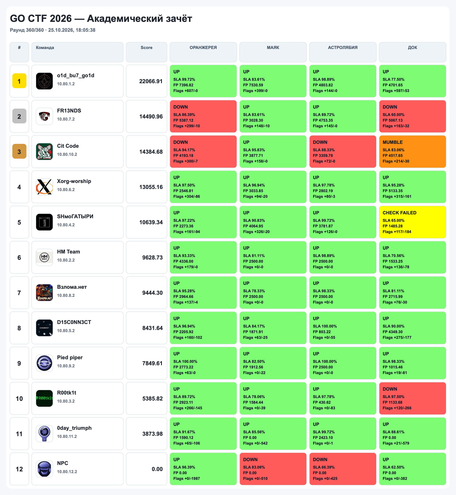
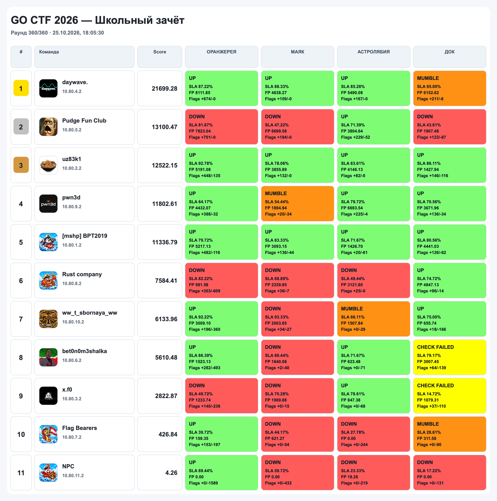

# GO CTF 2026 · «Орбитальный контроль»

Исходники задач Attack-Defence CTF **GO CTF 2026**: сервисы, чекеры и
reference-эксплоиты. Легенда - орбитальный флот: каждый сервис это модуль
станции, который команды защищают и атакуют.

## Скорборд

| Академический зачёт | Школьный зачёт |
|---|---|
|  |  |

## Сервисы

| Экран | Каталог | Категория | Стек | Порт |
|-------|---------|-----------|------|------|
| ОРАНЖЕРЕЯ  | [`greenhouse`](services/greenhouse)                 | pwn / web / misc | Python + нативный бинарь + three.js | `8080` |
| АСТРОЛЯБИЯ | [`orbital_navigation`](services/orbital_navigation) | web-logic        | Rust                                | `8086` |
| МАЯК       | [`lighthouse`](services/lighthouse)                 | crypto           | C++ + JS                            | `8085` |
| ДОК        | [`starpost`](services/starpost)                     | web              | Flask + nginx + PostgreSQL          | `8090` |

## Структура

```
.
├── services/     код сервисов
├── checkers/     чекеры Skipper AD
├── sploits/      reference-эксплоиты и разборы
└── images/       скриншоты скорборда
```

## Разбор уязвимостей

Каждый каталог в `sploits/` содержит README с одинаковой структурой: таблица
эксплоитов, по каждой уязвимости «суть / эксплуатация / патч» и список
зависимостей.

- [ОРАНЖЕРЕЯ](sploits/greenhouse) — use-after-free, рассинхрон авторизации по фрагменту URL, обратимая рекуррента
- [АСТРОЛЯБИЯ](sploits/orbital_navigation) — шесть логических уязвимостей (коллизии ID, SSRF, symlink и др.)
- [МАЯК](sploits/lighthouse) — chosen-plaintext на самодельный FEAL-подобный шифр
- [ДОК](sploits/starpost) — повторный промокод, обход подписи курсора, prefix-match контракта
